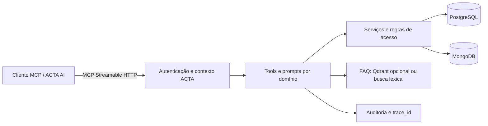

# 🔌 ACTA MCP

Servidor MCP que disponibiliza operações autorizadas dos domínios do ACTA para apoiar o ciclo **PDCA** (*Plan, Do, Check, Act*). Ele conecta clientes de IA aos dados e serviços do ACTA sem transferir ao modelo a identidade do usuário ou as regras de acesso.

## 📌 Visão geral

O `acta-mcp` publica ferramentas, um catálogo de ferramentas e prompts pelo [Model Context Protocol (MCP)](https://modelcontextprotocol.io/). O sistema cliente, como o [`acta-ai`](https://github.com/AppActa/acta-ai), decide quando chamar cada ferramenta e como apresentar a resposta; o servidor MCP valida o contexto autenticado, aplica as regras de domínio e consulta PostgreSQL ou MongoDB.

O serviço atende operações de ciclos PDCA, tarefas, colaboradores, formulários, treinamentos, relatórios, lições aprendidas e FAQ conceitual. Memória de conversas e skills pessoais pertencem ao sistema cliente e não fazem parte deste servidor.

## ✨ Funcionalidades

| Domínio | Capacidades |
| --- | --- |
| Ciclos | Buscar ciclos acessíveis e consultar visão geral, problemas, causas, riscos, participantes e treinamentos; registrar informações permitidas. |
| Tarefas | Consultar tarefas, atrasos, responsáveis e alertas; criar tarefas e atualizar dados e status conforme as permissões do ciclo. |
| Colaboradores | Consultar participantes, detalhes, carga de trabalho e sugestões de realocação, respeitando o escopo empresarial ou do ciclo. |
| Formulários | Consultar formulários e respostas, criar rascunhos, adicionar perguntas e publicar formulários. |
| Relatórios e treinamentos | Reunir contexto de um ciclo para relatórios e criar treinamentos com participantes. |
| Lições aprendidas | Gerar uma lição com base em evidências do ciclo, produzir um PDF, resumir lições e responder perguntas com referências. |
| FAQ | Pesquisar conteúdo conceitual do ACTA e do PDCA por busca semântica no Qdrant ou por busca lexical local. |

O servidor também publica o resource `acta://catalog/tools` e os prompts `analisar_ciclo` e `gerar_relatorio_ciclo`. O [catálogo completo](docs/tools.md) descreve operações, escopos e limites. Não há ferramenta para executar SQL livre ou consultar o MongoDB arbitrariamente.

## 🏗️ Arquitetura e segurança



Em HTTP, o servidor recebe uma chave de serviço Bearer e os identificadores do usuário e da empresa nos cabeçalhos. O PostgreSQL confirma o usuário, a empresa, o perfil e o acesso ao ciclo. As ferramentas recebem argumentos de domínio, não identidade ou permissões fornecidas pelo modelo. O modo `disabled` existe para desenvolvimento e testes locais e é recusado quando `ACTA_ENV=production`.

O PostgreSQL fornece dados transacionais e autorizações; o MongoDB armazena formulários e lições aprendidas. O Qdrant é opcional para a busca semântica do FAQ; sem ele, a busca usa o conteúdo local. A geração de lições aprendidas usa Gemini e o anexo PDF é armazenado no Cloudinary.

## 🛠️ Tecnologias

| Tecnologia | Uso |
| --- | --- |
| Python 3.11+ | Linguagem e versão mínima declarada pelo projeto; o contêiner e a CI usam Python 3.12. |
| MCP SDK 1.28.1 | Servidor FastMCP, ferramentas, resources, prompts e transporte Streamable HTTP. |
| PostgreSQL 16 | Persistência relacional; versão usada pelo ambiente local de desenvolvimento e integração. |
| MongoDB 7 | Persistência documental; versão usada pelo ambiente local de desenvolvimento e integração. |
| Qdrant | Índice vetorial opcional para busca semântica no FAQ. |
| Gemini | Embeddings do FAQ semântico e geração, resumo e perguntas sobre lições aprendidas. |
| Cloudinary | Armazenamento dos PDFs gerados para lições aprendidas. |
| Docker Compose | Serviços de banco locais usados no desenvolvimento e nos testes. |
| GitHub Actions | Validação de qualidade e publicação da imagem de contêiner no GHCR após push em `main`. |

As versões dos bancos na tabela correspondem aos serviços declarados em [`docker-compose.yml`](docker-compose.yml), usados para desenvolvimento e integração; o projeto não fixa a versão dos bancos de produção.

## ✅ Pré-requisitos e configuração

Para executar localmente, tenha Python 3.11 ou superior, [uv](https://docs.astral.sh/uv/), Docker com Docker Compose e acesso ao banco ACTA compatível com os domínios que deseja utilizar. O Compose do repositório inicia PostgreSQL e MongoDB com fixtures reduzidas para desenvolvimento e testes; ele não provisiona um banco completo de produção.

Crie um arquivo de ambiente local a partir do exemplo:

```powershell
Copy-Item .env.example .env
```

Revise a chave de API e as URLs de PostgreSQL e MongoDB para o seu ambiente. Para as portas publicadas pelo Compose, os valores de exemplo são `localhost:5433` e `localhost:27018`. Não versione chaves, URLs com credenciais ou outros segredos.

| Configuração | Finalidade |
| --- | --- |
| `ACTA_ENV`, `ACTA_AUTH_MODE`, `ACTA_MCP_API_KEY` | Ambiente e autenticação do transporte HTTP. Em produção, use `ACTA_AUTH_MODE=api_key` e uma chave forte. |
| `DATABASE_URL`, `MONGODB_URI`, `MONGODB_DATABASE` | Conexões e banco documental usados pelo serviço. |
| `GEMINI_API_KEY` | Necessária para gerar, resumir ou consultar lições aprendidas; também é necessária em produção e para embeddings quando o FAQ usa Qdrant. |
| `QDRANT_CLUSTER_ENDPOINT`, `QDRANT_API_KEY` | Configuram o índice vetorial opcional do FAQ. Sem ambos, é usada a busca lexical local. |
| `CLOUDINARY_CLOUD_NAME`, `CLOUDINARY_API_KEY`, `CLOUDINARY_API_SECRET` | Credenciais para enviar o PDF da lição aprendida ao Cloudinary. |
| `PORT`, `ACTA_HOST`, `ACTA_LOG_LEVEL` | Porta, endereço de escuta e nível de log do servidor. |

A lista completa, valores padrão e detalhes de configuração estão em [Configuração](docs/configuration.md). Para implantação no Render, consulte [Deploy](docs/deployment.md).

## 🚀 Execução local

Instale as dependências e inicie os bancos locais:

```powershell
uv sync --extra dev
docker compose up -d --wait
```

Para iniciar o servidor HTTP em ambiente local, defina o modo de autenticação de desenvolvimento e execute:

```powershell
$env:ACTA_ENV = "development"
$env:ACTA_AUTH_MODE = "disabled"
uv run python -m acta_mcp.main --transport http
```

O transporte HTTP usa a porta `8000` por padrão. O endpoint MCP fica em `http://127.0.0.1:8000/mcp` e a verificação de saúde em `http://127.0.0.1:8000/health`. O endpoint de saúde verifica PostgreSQL e MongoDB e retorna HTTP `503` se algum deles estiver indisponível.

Para desenvolvimento, a integração local exige `ACTA_AUTH_MODE=disabled`; nesse modo o contexto usa `ACTA_DEFAULT_USUARIO_ID` e `ACTA_DEFAULT_EMPRESA_ID`, ou os cabeçalhos correspondentes. O usuário ainda precisa existir, estar ativo e pertencer à empresa informada no PostgreSQL. Não use esse modo em produção. Para configurar um cliente HTTP autenticado ou executar via stdio, siga [Autenticação](docs/authentication.md) e [Configuração](docs/configuration.md).

## 🔌 Integração MCP

O transporte HTTP usa MCP Streamable HTTP sem sessão persistente. Em produção, cada requisição ao caminho `/mcp` deve incluir:

```http
Authorization: Bearer <ACTA_MCP_API_KEY>
X-Acta-Usuario-Id: <ID_DO_USUARIO>
X-Acta-Empresa-Id: <ID_DA_EMPRESA>
X-Trace-Id: <UUID_OPCIONAL>
```

O serviço cliente deve preencher os identificadores a partir da identidade autenticada no ACTA. O servidor consulta o perfil persistido e valida o vínculo com a empresa e, conforme a operação, com o ciclo solicitado. Consulte as regras completas de leitura e escrita em [Autenticação e autorização](docs/authentication.md).

Também há transporte `stdio` para clientes locais. Ele exige `ACTA_AUTH_MODE=disabled` e usa os identificadores padrão configurados no ambiente; por isso, destina-se apenas a desenvolvimento e testes.

## 🧪 Validação e fluxo de entrega

O fluxo de qualidade definido no repositório verifica o lockfile, a configuração do Compose, o lint com Ruff e os testes com cobertura mínima configurada de 80%. A CI usa Python 3.12. Após push em `main`, outro workflow constrói a imagem e publica uma tag baseada no SHA do commit no GHCR.

Para executar a validação local completa, com Docker e `uv` disponíveis:

```powershell
make validate
```

O manifesto [`render.yaml`](render.yaml) descreve um Web Service Docker, e o [`Dockerfile`](Dockerfile) inicia o transporte HTTP. A validação local não confirma conexão com serviços externos nem a implantação de produção.

## 📁 Estrutura

```text
.
├── .github/workflows/  # qualidade, integração e publicação da imagem
├── docs/               # arquitetura, configuração, segurança e catálogo de tools
├── migrations/         # notas sobre fixtures e migrações
├── scripts/            # verificações operacionais
├── src/acta_mcp/
│   ├── core/           # configuração, contexto, autenticação e auditoria
│   ├── infrastructure/ # conexões e adaptadores de persistência
│   ├── modules/        # tools, serviços e repositórios por domínio
│   ├── prompts/        # prompts MCP
│   ├── resources/      # resources MCP
│   ├── registry.py     # registro de tools, resources e prompts
│   └── server.py       # servidor, transporte HTTP e health check
├── tests/              # testes unitários, de contrato e integração
├── Dockerfile
├── docker-compose.yml
├── pyproject.toml
└── README.md
```

## 📚 Documentação

- [Arquitetura e ciclo de requisição](docs/architecture.md)
- [Autenticação e autorização](docs/authentication.md)
- [Catálogo de tools](docs/tools.md)
- [Configuração local e variáveis](docs/configuration.md)
- [Deploy no Render](docs/deployment.md)

## 🤝 Links e autoria

- [Repositório](https://github.com/AppActa/acta-mcp) · [Licença MIT](LICENSE) · `acta.institutojef@gmail.com`
- Contribuições: use *issues* e *pull requests*; há um [`PULL_REQUEST_TEMPLATE.md`](PULL_REQUEST_TEMPLATE.md).
- Autoria: Equipe ACTA.
